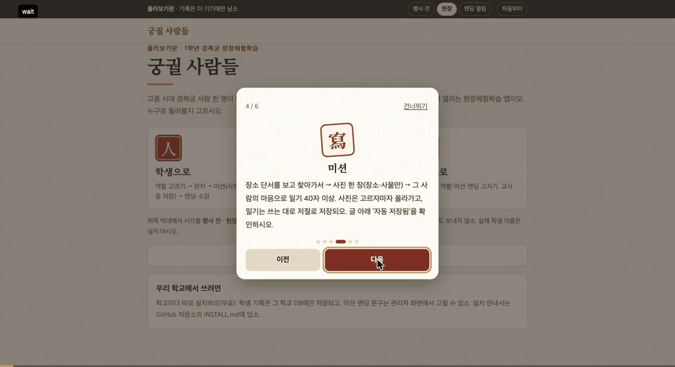
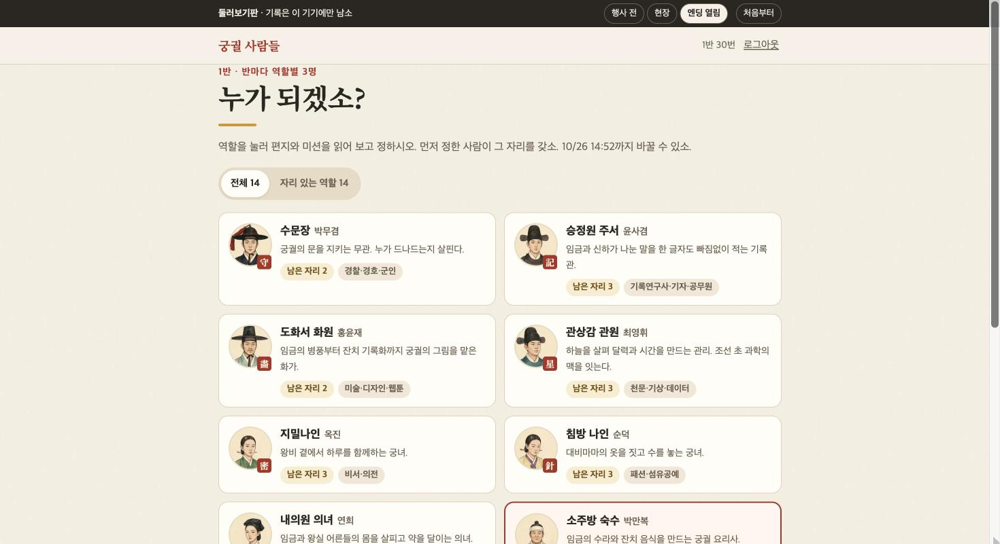
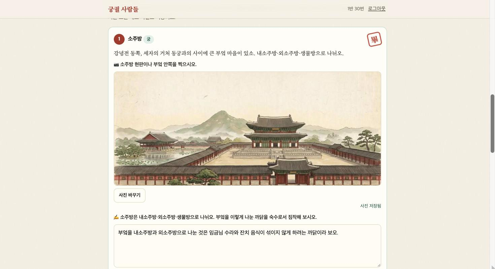
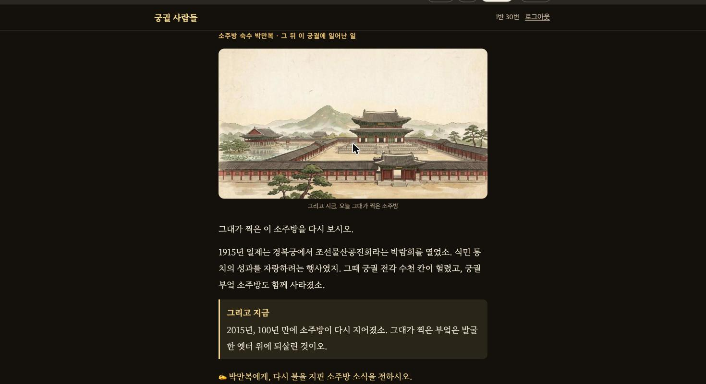
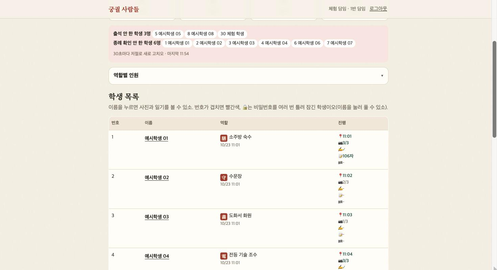
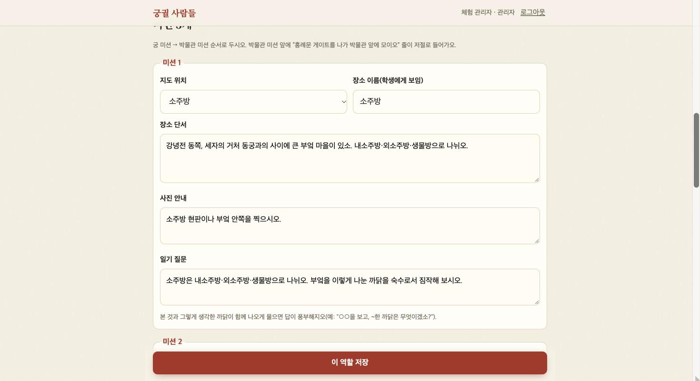

# 궁궐 사람들 키트

경복궁·국립고궁박물관 현장체험학습용 **1인 1역 미션 웹앱**입니다. 학생 한 명이 1890년 무렵 고종 시대 경복궁의 한 사람(수문장, 승정원 주서, 도화서 화원, 의녀, 전등 기술 조수 등 14개 역할)이 되어, 편지를 읽고 궁과 박물관에서 미션 3개(장소 단서 → 사진 → 그 인물의 목소리로 쓰는 일기)를 합니다. 정해진 시각이 되면 모두에게 엔딩이 한꺼번에 열립니다. 엔딩에서는 내가 찍은 장소가 일제강점기에 어떻게 훼손되었고 지금 어떻게 복원되었는지 보여 줍니다. 마지막에 인물에게 한마디를 남기고, 학생 자신의 말로 소감을 씁니다.

서울 선유고등학교가 2026년 10월 1학년 7개 반과 실제로 운영한 앱을, 다른 학교도 쓸 수 있게 고친 판입니다. 만든 사람: **선유고 이재영(이복덕쌤)**

## 둘러보기

**https://gunggwol-kit-demo.vercel.app** — 설치 없이 학생·담임·관리자 화면을 둘러보는 판입니다. 서버 없이 이 기기 안에서만 돌고, 위쪽 막대에서 시각(행사 전·현장·엔딩 열림)을 바꿔 볼 수 있습니다. 담임 화면의 학생은 모두 예시입니다.

| 역할 고르기 | 미션(자동 저장) | 엔딩 |
| --- | --- | --- |
|  |  |  |
| **담임 현황** | **관리: 미션 편집** | |
|  |  | |

## 학교마다 따로 설치합니다

각 학교가 **자기 Supabase(DB)와 Vercel(웹)**에 설치합니다. 학생 사진·글은 그 학교 계정에만 저장되고, 다른 학교나 이 저장소를 만든 사람은 볼 수 없습니다. 무료 요금제로 충분합니다.

설치 순서는 **[INSTALL.md](INSTALL.md)**에 있습니다. 약 30분~1시간 걸립니다.

## 기능

**학생**
- 입장 코드 + 반·번호·이름 + 숫자 4자리 비밀번호로 들어옵니다(학교 구글 계정 로그인도 고를 수 있음). 다른 휴대폰에서도 이어서 쓸 수 있습니다.
- 처음 들어오면 **사용법 카드**가 뜨고, 언제든 다시 볼 수 있습니다.
- 역할 고르기(반마다 역할별 정원, 마감 시각까지 바꿀 수 있음) → 편지 → 경복궁 실제 지도 위의 동선
- 미션: 사진은 고르자마자 올라가고, 일기·한마디·소감은 **쓰는 대로 저절로 저장**됩니다. 서버와 기기 양쪽에 남고, 화면을 닫거나 다른 앱으로 넘어가도 저장을 한 번 더 보냅니다.
- 함께 다니기: 같은 반 최대 3명이 코드로 모이면 궁 미션 장소를 가장 짧게 잇는 동선과 걸리는 시간을 알려 줍니다.
- 엔딩: 내가 찍은 사진을 세피아로 띄운 채 이야기를 넘기다가 “그리고 지금”에서 원래 색으로 돌아옵니다. 일부 역할은 훼손 당시의 옛 사진이 나옵니다.

**선생님**
- 담임: 맡은 반 등록·역할·출석·미션·소감 현황(현장 시간에 30초마다 새로 고침), 학생 기록 보기, 응답 CSV(질문은 학생이 답할 때의 문구 그대로), 비밀번호 지우기, 학생으로 체험하기
- 관리자: 행사 날짜·시각, 반 수, 정원, 글자 수 기준, 입장 코드, 로그인 방식, 현장 수칙·개인정보 안내, **역할·편지·미션·엔딩 편집**(역할 켜기·끄기·추가), 교사 계정, 학년도 말 기록 지우기

## 구조

| 경로 | 내용 |
| --- | --- |
| `web/` | 앱(정적 HTML·JS, 빌드 없음). `app.js` 학생·교사, `admin.js` 관리, `guide.js` 사용법 카드, `map.js`·`mapdata.js` 지도 |
| `supabase/install.sql` | 설치 SQL(자동 생성). 원본은 `schema.sql` + `content/*.json` → `node scripts/build-install.mjs` |
| `supabase/uninstall.sql` | 모두 지우기 |
| `scripts/make-config.mjs` | Vercel 빌드 때 환경변수로 `web/config.js`를 만듦 |
| `vercel.json` | 빌드 설정, 보안 헤더(CSP) |
| `web/demo.js` | 둘러보기판(Vercel 환경변수 `GP_DEMO=1`): Supabase 대신 이 기기 안에서 답하는 가짜 백엔드 |

보안: 모든 표는 RLS를 켜고 정책을 두지 않았습니다. 앱은 표를 직접 읽거나 쓰지 못하고, 학생·담임·관리자를 함수 안에서 다시 확인하는 `security definer` 함수로만 다룹니다. 사진 보관함은 비공개이고, 본인·맡은 반 담임·관리자만 볼 수 있습니다.

## 출처·라이선스

**CC BY-NC 4.0** (저작자표시-비영리) — © 2026 선유고 이재영(이복덕쌤). 학교·교육청·연수에서 무료로 설치하고 고쳐 쓰고 다시 나눌 수 있습니다. 출처를 밝혀 주시고, 판매·유료 서비스 같은 상업적 이용은 먼저 허락을 받아 주세요. 원문은 [LICENSE](LICENSE), 한국어 안내와 예외는 [NOTICE.md](NOTICE.md)에 있습니다.

다른 라이선스를 따르는 부분: supabase-js(MIT), Noto Serif KR 글꼴(OFL), 지도 데이터(© OpenStreetMap contributors, ODbL — 앱 지도의 출처 표기를 지우지 마세요), 엔딩 옛 사진(위키미디어 공용 퍼블릭 도메인, `docs/옛사진_출처.txt`). 역할 인물 그림·오프닝 그림은 Notion AI로 만든 뒤 교사가 검수한 상상화입니다.
